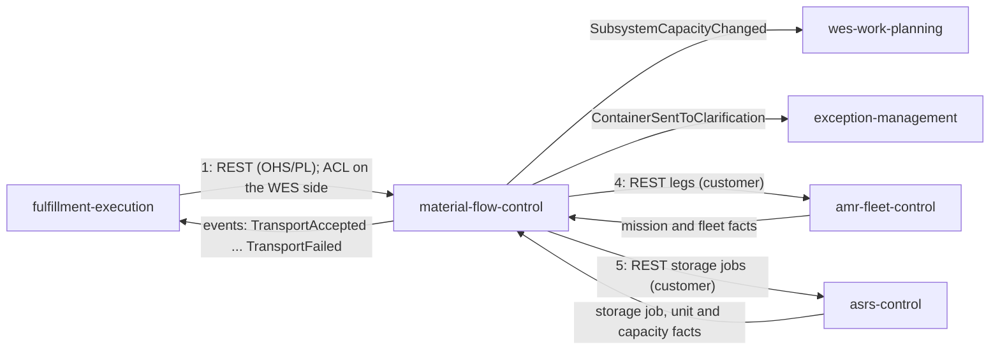

# Context map

| # | Relationship | Pattern | Contract |
| --- | --- | --- | --- |
| 1 | fulfillment-execution to material-flow-control | Open Host Service + Published Language; the WES's `EquipmentCommandPort` adapter is its ACL | `apis/openapi.yaml`, `apis/asyncapi.yaml` |
| 4 | material-flow-control to amr-fleet-control | customer/supplier, same REST shape | amr-fleet-control `apis/openapi.yaml`, pinned under `contracts/` |
| 5 | material-flow-control to asrs-control | customer/supplier, same REST shape | asrs-control `apis/openapi.yaml`, pinned under `contracts/` |

Rules the map enforces: the WES never addresses a robot, a node, a shuttle or a rack position (one door to the WES);
MQTT stays inside the subsystem controllers (no MQTT import here); there is no WCS link to the stock ledger.
Read-only consumers (warehouse-ops-agent, warehouse-console) use the [agent surfaces](/docs/ecosystem/agents).
