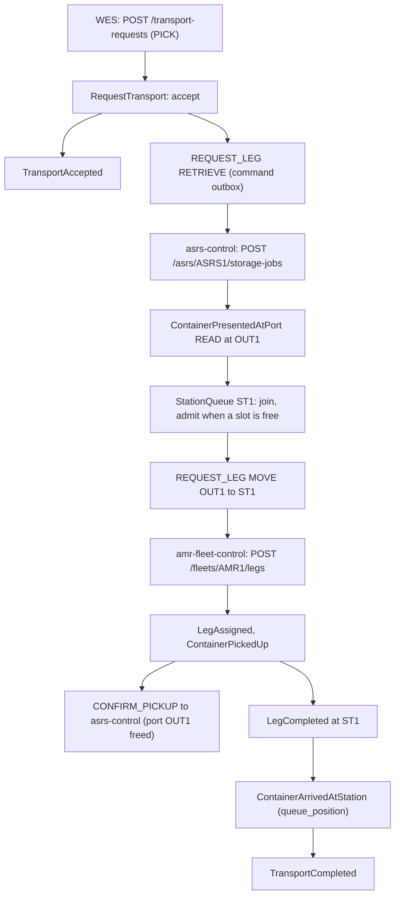

# Domain message flow

A PICK from the AS/RS to station `ST1`:

The failure paths (no-read, leg failure, timeout, cancellation) are on [Transport lifecycle](/docs/domain/transport-lifecycle)
and [Clarification](/docs/domain/clarification).
