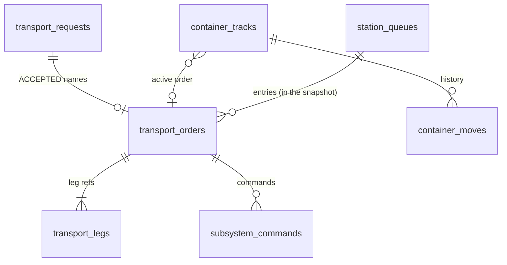

# Entity relationship

Standalone tables: `flow_lock` (one row), `subsystem_capacities`, `equipment_units`, `processed_events` (the inbox),
`outbox_events` (the outbox) and `idempotency_keys`. Aggregates are JSONB snapshots (`record`, `snapshot`, `move`,
`state`); the other columns exist for lookups and indexes. The full list is on
[Architecture](/docs/overview/architecture#storage); the schema is `migrations/0001_material_flow_control_schema.up.sql`.
