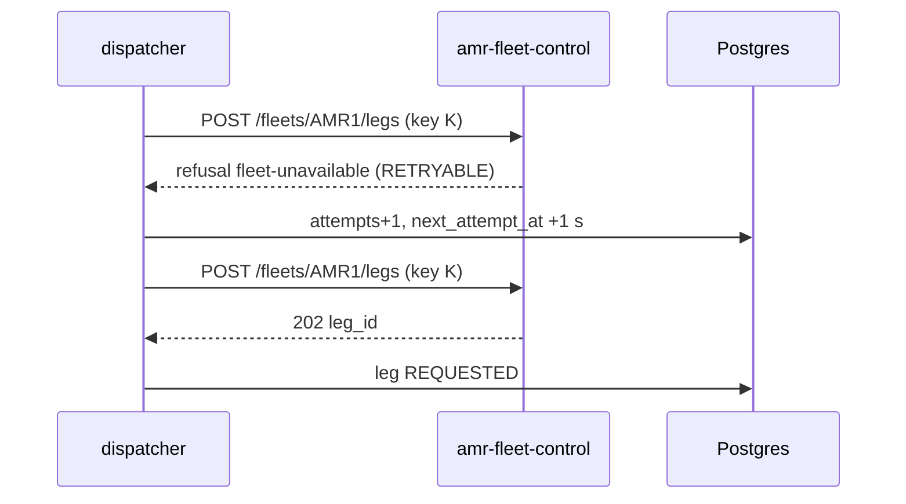

# Sequence diagrams

## Accept, then the first leg

```mermaid
sequenceDiagram
  participant WES as fulfillment-execution
  participant API as cmd/api
  participant DB as Postgres
  participant D as dispatcher
  participant A as asrs-control
  WES->>API: POST /transport-requests (Idempotency-Key)
  API->>DB: lock flow_lock; record ACCEPTED; order, track, REQUEST_LEG, outbox, key
  API-->>WES: 202 TransportOrder
  API->>D: kick (after commit)
  D->>A: POST /asrs/ASRS1/storage-jobs (reference, Idempotency-Key)
  A-->>D: 202 storage_job_id
  D->>DB: lock flow_lock; leg REQUESTED, command DONE
```

## A rejection (OUTCOME)

```mermaid
sequenceDiagram
  participant WES as fulfillment-execution
  participant API as cmd/api
  participant DB as Postgres
  WES->>API: POST /transport-requests (busy container)
  API->>DB: lock flow_lock; record REJECTED; TransportRejected in the outbox; the 422 stored under the key
  API-->>WES: 422 container-busy (reason CONTAINER_BUSY)
  WES->>API: the same POST, same key
  API-->>WES: 422 replayed (Idempotency-Replayed: true), nothing created
```

## A retried leg request


