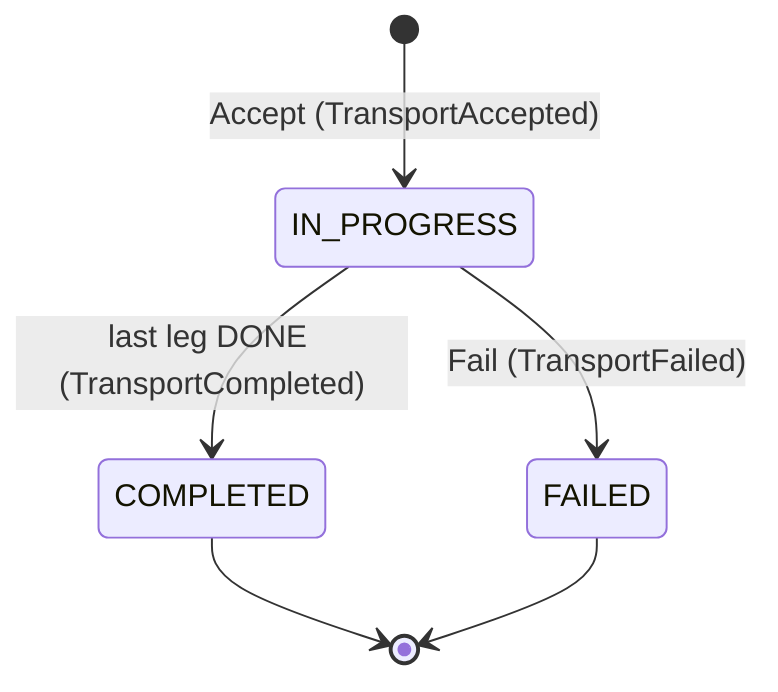
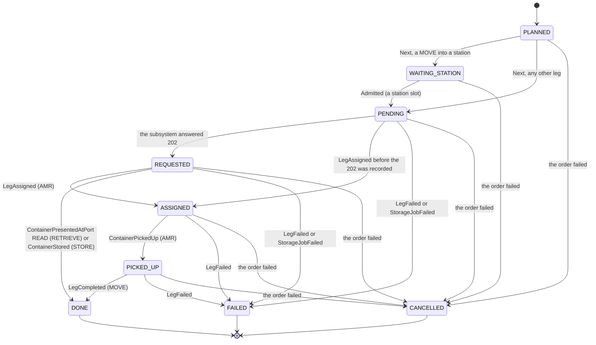

# Transport lifecycle

## The order (`transportorder.Status`)

`FAILED` carries a reason: `CLARIFICATION`, `SUBSYSTEM_FAULT`, `CANCELLED` or `TIMEOUT`, plus the subsystem's bare
reason in `subsystem_reason` and the container's last confirmed location in `container_location`. A PICK publishes
`ContainerArrivedAtStation` and then `TransportCompleted`. The REST view adds two statuses that are not order states:
`CANCEL_REQUESTED` (an `IN_PROGRESS` order whose cancellation was asked of the subsystem) and `REJECTED` (a request
that never got an order).

## A leg (`transportorder.LegStatus`)

Only a subsystem's failure fact ends a leg `FAILED` (`LegFailed` from amr-fleet-control, `StorageJobFailed` from
asrs-control). When the order fails for any other reason (`LEG_TIMEOUT`, a FINAL refusal, the request deadline, a
cancellation, another leg's failure), `Order.Fail` abandons every leg that has not ended: it ends `CANCELLED`, so
`get_transport` and `transport_status` show a timed-out or refused leg as `CANCELLED`, not `FAILED`.

Facts can arrive out of order: `ContainerPickedUp` or `LegCompleted` on a MOVE that is still `PENDING`, `REQUESTED`
or `ASSIGNED` moves it straight on. A fact is matched by the leg reference `<orderId>.<seq>.<attempt>` and must fit the leg's kind (`Presented` a
RETRIEVE, `Stored` a STORE, `Assigned`/`PickedUp`/`Delivered` a MOVE); a fact for another kind is skipped with a log
line. A fact never moves a leg back: a fact may arrive before the dispatcher recorded the subsystem's `202`.

## Retries and re-plans (decision D13)

| Failure | Handling |
| --- | --- |
| AMR `LegFailed` before the pickup (`container_on_robot` false) with `ROBOT_BLOCKED`, `ROBOT_FAULT`, `ROBOT_OFFLINE`, `ORDER_REJECTED` or `MAP_VERSION_RETIRED` | a NEW attempt of the same leg (new reference, new key), up to `LEG_RETRY_LIMIT` per order; then `SUBSYSTEM_FAULT` |
| AMR `LegFailed` `PICK_FAILED` | the container is held at clarification; the transport fails `CLARIFICATION` |
| AMR `LegFailed` with the container on the robot | the container is held `CONTAINER_ON_FAILED_ROBOT`; the transport fails `SUBSYSTEM_FAULT` |
| asrs-control `StorageJobFailed` on a STORE with `EQUIPMENT_FAULT`, `EQUIPMENT_UNREACHABLE` or `PORT_OCCUPIED` | re-planned ONCE through another input port of the same AS/RS (a MOVE from the failed port, then STORE) |
| `StorageJobFailed` `CONTAINER_NOT_AT_PORT` or `STORAGE_MAP_MISMATCH` | clarification; the transport fails `CLARIFICATION` |
| any other failed RETRIEVE or STORE | `SUBSYSTEM_FAULT` |
| a leg request refused RETRYABLE, a 5xx, a timeout | retried under the same key (1 s to 30 s) until `LEG_REQUEST_DEADLINE_SECONDS`; then `SUBSYSTEM_FAULT` |
| a leg request refused FINAL | `SUBSYSTEM_FAULT` at once, logged at ERROR |
| no progress fact for `LEG_TIMEOUT_SECONDS` | `TIMEOUT` and a best-effort `CANCEL_LEG` |

## Cancellation (decision D15)

`POST /transport-requests/{transportRequestId}/cancellation`:

| The container is | Answer |
| --- | --- |
| between legs at a confirmed handoff that is not an AS/RS output port (including waiting for a station slot) | `200`, `TransportFailed` `CANCELLED` at once |
| in a leg not yet picked up, which does not start at an AS/RS output port | `202` `CANCEL_REQUESTED` and a `CANCEL_LEG`; the subsystem's `CANCELLED` ends the transport `CANCELLED`; a refusal, or a leg that completes first, lets it run to its normal outcome |
| on a robot, or waiting on an AS/RS output port (ruling P4-R6) | `409 transport-not-cancellable` |
| in an ended or rejected request | `409 transport-ended` |
