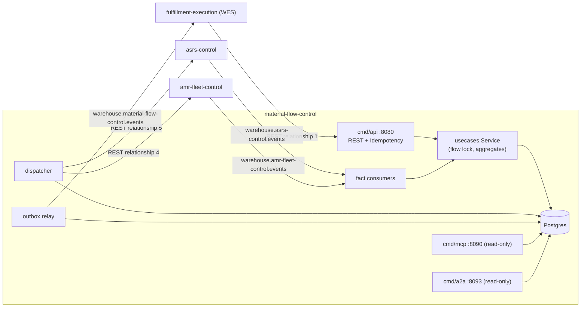

# Architecture

## Three binaries

| Binary | Port | What it runs |
| --- | --- | --- |
| `cmd/api` | `:8080` (`ADDR`) | The relationship-1 REST interface, the two subsystem fact consumers (`warehouse.asrs-control.events`, `warehouse.amr-fleet-control.events`), the subsystem command dispatcher, the leg-timeout tick, the outbox relay and the hourly purge. One replica. |
| `cmd/mcp` | `:8090` (`MCP_ADDR`) | The read-only MCP server (Streamable HTTP, stateless): five L1 tools, one resource, one prompt. |
| `cmd/a2a` | `:8093` (`A2A_ADDR`) | The read-only A2A agent (JSON-RPC 2.0, Agent Card at `/.well-known/agent-card.json`): five L1 skills. |

`cmd/mcp` and `cmd/a2a` wire only the read repositories and the layout into `usecases.Reader`: no unit of work, flow
lock, outbox, command outbox, inbox, subsystem client or Kafka client (fitness tests in `internal/architecture` enforce
the imports and refuse write methods). See [Agents](/docs/ecosystem/agents).

## The hexagon

```text
internal/domain/            pure: layout, routing, transportrequest, transportorder, containertrack, stationqueue, capacity
internal/application/       ports (interfaces, sentinel errors), facts, command, idempotency, outbox, usecases
internal/adapters/inbound/  http (REST + Idempotency middleware), kafka (two consumers + DLQ), mcp, a2a, requestlog
internal/adapters/outbound/ postgres, asrs, amr, subsystemhttp, events, outbox, kafka, telemetry, system, memory (tests only)
internal/config/            the layout YAML loader
cmd/api, cmd/mcp, cmd/a2a   composition roots: the only place that wires adapters
```

`internal/domain/**` imports only the standard library and itself; `internal/application/**` only the domain and
itself; inbound and outbound adapters never import each other; no `cmd/` imports `internal/adapters/outbound/memory`.
arch-go and the fitness tests in `internal/architecture` fail the build otherwise.

## Serial writes: the flow lock

Every write unit of work (a REST POST, a Kafka fact, a dispatcher answer, a tick) first takes the flow lock:
`SELECT ... FOR UPDATE` on the single `flow_lock` row (decision D19, [ADR 0002](/docs/adr/0002-material-flow-layout-routing-and-the-command-outbox)).
Orders, tracks and queues therefore change serially, whatever the source. Each transaction sets
`SET LOCAL statement_timeout = '5s'` and `SET LOCAL lock_timeout = '5s'` (safe under PgBouncer transaction pooling).

## No subsystem call inside a transaction: the command outbox

A use case never calls a subsystem. It inserts a `subsystem_commands` row (`REQUEST_LEG`, `CANCEL_LEG`,
`CONFIRM_PICKUP`) in its unit of work. One dispatcher goroutine (`Service.DispatchDue`, woken by an after-commit kick
and a `DISPATCH_POLL_MS` poll) calls `asrs-control` or `amr-fleet-control` with the command's `Idempotency-Key`
OUTSIDE any transaction, then applies the answer in a new unit of work. A RETRYABLE refusal, a 5xx, a timeout or a
refused connection is retried under the same key (1 s to 30 s backoff) until `LEG_REQUEST_DEADLINE_SECONDS` after the
first attempt; a FINAL refusal fails the transport at once. Facts are matched by this context's leg reference
`<orderId>.<seq>.<attempt>`, so a fact that arrives before the dispatcher recorded the subsystem's `202` still applies.

## Events out: the transactional outbox

Every domain event is encoded to CloudEvents 1.0 structured mode in the unit of work that raised it and written to
`outbox_events` twice (`warehouse.material-flow-control.events` and `.analytics`, one id). The relay publishes the rows
(`OUTBOX_INTERVAL_MS`, `OUTBOX_BATCH`, attempt cap `OUTBOX_MAX_ATTEMPTS`) with a kafka-go writer that sets
`RequiredAcks: RequireAll`, `BatchTimeout: 10ms` and 10 s write/read timeouts.

## Components



## Storage

| Table | Holds |
| --- | --- |
| `flow_lock` | the one row every write unit of work locks first |
| `transport_requests` | the ONE outcome of every `transport_request_id` (ACCEPTED or REJECTED) |
| `transport_orders` | the `TransportOrder` snapshot (JSONB) per order, in acceptance order (`seq`) |
| `transport_legs` | leg reference to order, the key every subsystem fact is matched by |
| `container_tracks` | the `ContainerTrack` snapshot per container (position, active order, clarification) |
| `container_moves` | each container's move history (the last 20 are served) |
| `station_queues` | the `StationQueue` snapshot per station |
| `subsystem_capacities` | the latest capacity snapshot per subsystem and station |
| `equipment_units` | the last `EquipmentStateChanged` per AS/RS unit (read by the agents) |
| `subsystem_commands` | the command outbox (`status`, `attempts`, `next_attempt_at`, `deadline`, `last_error`) |
| `processed_events` | the consumers' inbox, keyed by the CloudEvents id (purged after 30 days) |
| `outbox_events` | the transactional outbox of published events |
| `idempotency_keys` | stored POST answers (2xx, FINAL and OUTCOME 4xx; purged after 24 hours) |

Aggregates are stored as the JSON of their domain `Snapshot`; migrations are embedded (`migrations/`) and run at boot
by every binary against `MIGRATIONS_DATABASE_URL` (default `DATABASE_URL`).
